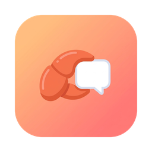
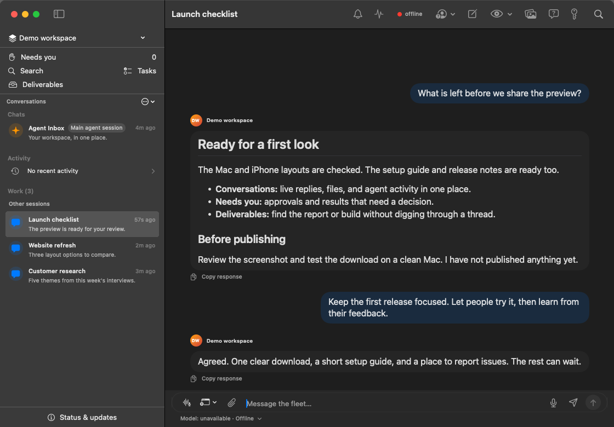

# Cast

<p align="center">
  
</p>

<p align="center"><strong>A native command center for OpenClaw on iPhone and Mac.</strong></p>

Cast brings conversations from your OpenClaw gateways into one focused Apple-platform app.
Follow live agent work, search conversations, review approvals, and find shared files without
living in a browser tab or terminal.


*The real Mac interface with fictional demo conversations. No live workspace or customer data is shown.*

## Downloads

**[Download Cast for Mac](https://github.com/jeffweisbein/cast/releases/download/v0.4.0-preview.4/Cast-0.4.0-preview.4-macOS-arm64.zip)** ·
[Release notes](https://github.com/jeffweisbein/cast/releases/tag/v0.4.0-preview.4) ·
[SHA-256 checksum](https://github.com/jeffweisbein/cast/releases/download/v0.4.0-preview.4/SHA256SUMS-preview4.txt)

| Platform | Available now |
| --- | --- |
| **Mac — Apple Silicon, macOS 15+** | Signed and Apple-notarized **0.4.0 (17)** developer preview. Download the ZIP above, unzip, then move Cast.app to Applications. |
| **iPhone / iPad — iOS 26+** | [Build and sign with Xcode](CONTRIBUTING.md). No public TestFlight or App Store download yet. |

Cast needs a running OpenClaw gateway you control; it does not include hosted AI access
or a gateway. See [Requirements](#requirements).

Prefer to build it yourself? [Download the source preview](https://github.com/jeffweisbein/cast/releases/download/v0.4.0-preview.2/Cast-v0.4.0-preview.2-source.zip)
([source checksum](https://github.com/jeffweisbein/cast/releases/download/v0.4.0-preview.2/SHA256SUMS))
or browse [all releases](https://github.com/jeffweisbein/cast/releases). The source ZIP is not
an installable app; building requires Xcode 26.3 or newer and XcodeGen.

> **Developer preview:** Expect rough edges and gateway-version differences. Automatic app
> updates are not configured yet; download new releases manually.

## What Cast does

- Connects directly to one or more OpenClaw gateways
- Organizes human chats, agent sessions, tasks, and automation
- Streams answers and structured agent activity in real time
- Syncs authoritative unread state and shows native macOS Dock badges
- Searches conversations and keeps local media/link libraries
- Accepts text, URLs, images, and files through the iOS Share Extension
- Stores credentials and device identity in Apple Keychain

## Find your work

- **Search** in the sidebar (Cmd-K on Mac) finds saved messages, files, and work in the current workspace. Enable gateway history to include uncached history from listed conversations and recent task records.
- **Tasks** opens task details and the controls your gateway supports.
- **Needs you** collects approvals, blockers, failures, and results awaiting review.
- **Deliverables** keeps report, ZIP, PR, and release references across restarts. Refresh gateway attachments to discover, download, preview, save, or share generated files.
- **Status & updates** shows gateway compatibility, the installed version, conversation recovery, unconfirmed sends, and recent failures.

Click the model below the composer to choose a model and reasoning effort for that conversation.
See the [Continuity guide](docs/continuity.md) and [Session diagnostics](docs/session-diagnostics.md).
For signed builds, packaging, updates, and TestFlight, see the [Release guide](docs/releases.md).
Unconfigured update feeds remain disabled.

## Keep the sidebar focused

Right-click a conversation on Mac, or long-press it on iPhone, to **Pin Chat** or
**Hide from Sidebar**. Pinned chats appear above Agent Inbox. iPhone also offers
Hide as a swipe action. Hiding offers an eight-second **Undo**.

Use the sidebar's **… → Show hidden chats** option to find hidden conversations,
then choose **Show in Sidebar** to restore one. Hidden conversations stay hidden
when new messages arrive and are excluded from Cast's unread badges and native
notifications. Their history, drafts, and unread state are preserved; restoring a
conversation includes its unread count again. Search excludes hidden chats unless
Show hidden chats is enabled.

These preferences are saved locally per workspace and device. They do not archive
sessions, stop automation, or change notification settings in other apps.

## Requirements

Cast does not provide a hosted account or gateway. A tester needs:

1. A running OpenClaw gateway reachable from the device.
2. A fresh mobile setup code from an authorized OpenClaw Control UI, plus approval there if requested.
3. Cast’s first-run setup, which validates the connection before completing.

Credentials and device identity are stored in Keychain. Cast connects directly to the configured gateway; conversations come from that gateway and may be cached locally for continuity. Setup and privacy help can be reopened from the workspace menu.

Public-testing gates and current evidence: [docs/public-testing-readiness.md](docs/public-testing-readiness.md). Open-source publication gates are tracked separately in [docs/open-source-release-checklist.md](docs/open-source-release-checklist.md).

## Secure Secret Store entry

Open the **key / Secure entry** control in a conversation and enable secure requests for that workspace. Cast reconnects requesting `operator.questions`; approve the device permission upgrade in your Gateway if prompted. Bootstrap pairing keeps its original scope ceiling—finish pairing before enabling secure entry.

When an agent requests a Secret Store value, Cast shows a banner and a masked form for that conversation. Review the secret name, allowed destination hosts and any replacement warning, then choose **Save to Secret Store**. This handles pending Gateway requests; it is not a general Secret Store editor.

Values go directly through `question.resolve`, never `chat.send`, transcript history or Cast preferences. Closing, backgrounding or changing conversations clears the input. Cast does not automatically retry uncertain writes: check the Gateway Secret Store before retrying after a lost response. Existing Gateway authentication and transport settings still apply.

Requires a Gateway supporting `question.list`, `question.resolve` and Secret Store bindings. Live device permission approval and end-to-end secret submission must be verified against your Gateway after installing a signed build.

## Build from source

You need macOS, **Xcode 26.3 or newer** (select it with `xcode-select`), and XcodeGen.
The app supports macOS 15+ and iOS 26+. Internet is required to fetch pinned Swift packages.
A gateway, Apple signing account, Hex and Agent Desktop are **not** required to compile or run the offline tests.

```sh
brew install xcodegen
Scripts/generate-project.sh
xcodebuild -project Cast.xcodeproj -scheme Cast-macOS \
  -destination 'platform=macOS' build CODE_SIGNING_ALLOWED=NO
xcodebuild -project Cast.xcodeproj -scheme Cast-iOS \
  -destination 'generic/platform=iOS Simulator' build CODE_SIGNING_ALLOWED=NO
```

Unsigned output is for development validation, not daily installation. For signed Mac builds,
use your own team as below. For iPhone installation, register your own app/extension identifiers
and App Group; see [contributing](CONTRIBUTING.md). Optional local dictation and window access
have separate [setup requirements](docs/local-dictation-and-desktop.md).

Live development requires a running OpenClaw gateway. The conventional local URL is `ws://127.0.0.1:18789`. Token discovery:
`CAST_GATEWAY_TOKEN` env → `~/.openclaw/openclaw.json`.

Debug builds can expose a generic `ws://127.0.0.1:18789` development workspace by setting `CAST_INCLUDE_DEVELOPMENT_WORKSPACES=1`. No developer-specific hostnames or credentials are included in source.

## macOS signing

Keychain credentials require a stable Apple Development signature across rebuilds. On a Mac with
an Apple Development identity, build with the same team and bundle identifier each time:

```sh
xcodebuild -project Cast.xcodeproj -scheme Cast-macOS \
  -configuration Debug DEVELOPMENT_TEAM="$CAST_DEVELOPMENT_TEAM" \
  CODE_SIGN_STYLE=Automatic build
```

Do not install an ad-hoc-signed build for daily use. Cast never requires `sudo` or a root password.

## Security and privacy

Remote gateways require `wss://`; plain WebSocket connections are accepted only for loopback or private LAN addresses. Credentials stay in Keychain, and Cast does not proxy conversations through a hosted Cast service. See [SECURITY.md](SECURITY.md) for reporting and architecture notes.

## Contributing

Build conventions and pull-request expectations are documented in [CONTRIBUTING.md](CONTRIBUTING.md).

## License

Cast source is licensed under the Apache License 2.0. OpenClawKit-derived portions retain their upstream MIT attribution in [ATTRIBUTION.md](ATTRIBUTION.md) and [NOTICE](NOTICE).

Support: [SUPPORT.md](SUPPORT.md) · Privacy: [PRIVACY.md](PRIVACY.md) · [Community conduct](CODE_OF_CONDUCT.md).
